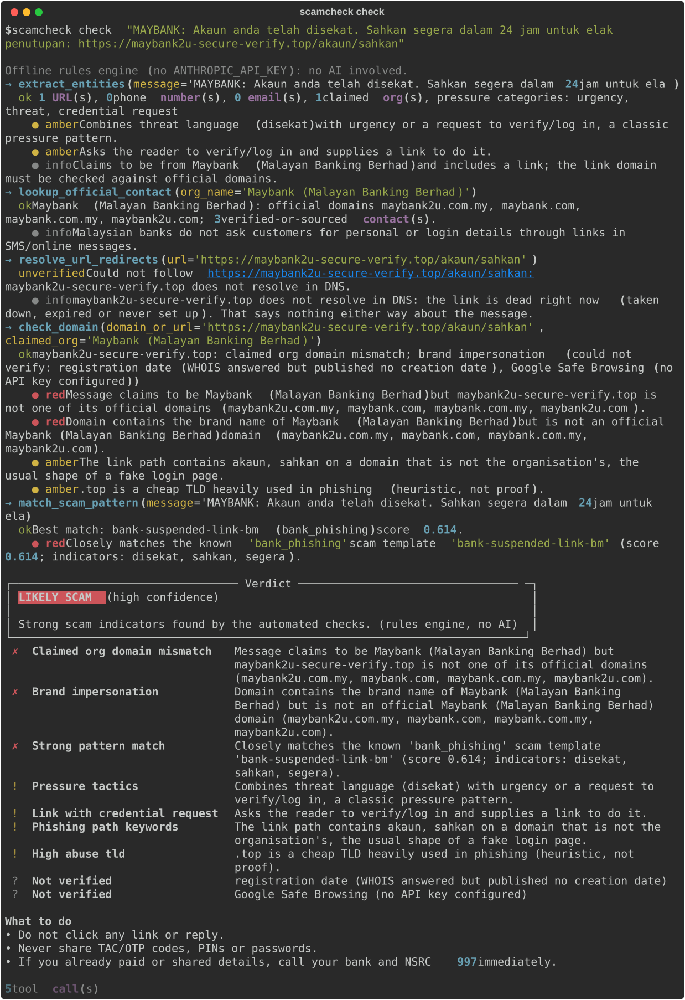
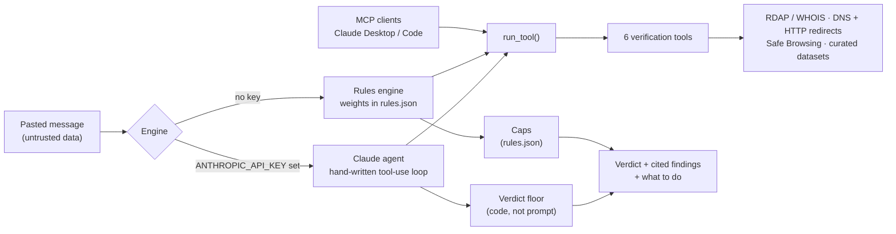

<div align="center">

# Scam Checker Agent

**An AI agent that investigates suspicious Malaysian SMS, WhatsApp and email messages the way a fraud
analyst would, and shows every check it ran.**

[](https://github.com/mshe0093/scam-checker-agent/actions/workflows/ci.yml)
[](pyproject.toml)
[](LICENSE)
[](docs/usage.md#mcp-server)
[](src/scamcheck/agent.py)

**[Try it live](https://scamcheck-4afb.onrender.com)** •
[Quick start](#quick-start) •
[How it works](#how-it-works) •
[What it checks](#what-it-checks) •
[Evaluation](#evaluation) •
[Docs](docs/README.md) •
[Roadmap](#roadmap)

</div>

Paste a message that claims to be from your bank, LHDN, Pos Laju or the police. Instead of
keyword-matching the text or asking a model to guess, Scam Checker **calls tools that verify the
claims**. It looks up the domain's registration date, follows redirects server-side, compares the
link with the organisation's real domains, and matches the text against known Malaysian scam patterns.
The verdict cites every check, and a red flag found by deterministic code can't be argued away by the model.

<p align="center">
  
  <br>
  <sub>A real run on a made-up scam, using the offline rules engine (no API key).</sub>
</p>

## Highlights

- **Verifies, doesn't guess.** Six tools return structured evidence:
  - RDAP with a WHOIS fallback
  - redirect resolution behind an SSRF guard
  - dnstwist lookalike detection
  - a sourced dataset of official contacts
  - scam-pattern matching
  - phone-number checks
- **Shows its work.** Every tool call and result streams live to the CLI, the web UI and the API.
- **Hard to talk out of a red flag.** A verdict floor in code stops "likely legitimate" whenever a
  deterministic check fires, such as a brand-impersonating domain, a Safe Browsing hit or a domain under 30 days old.
- **Prompt-injection aware.** The pasted message is treated as untrusted data, so a scam that says
  "ignore previous instructions" just becomes more evidence.
- **Built for Malaysia.** It understands English and Bahasa Malaysia pressure language, Malaysian phone
  formats and `.my` WHOIS. It knows the real domains of every retail bank, Islamic bank and digital
  bank on Bank Negara's register, plus the main e-wallets, agencies, couriers and telcos. Each domain
  was checked by hand ([how](docs/data-sources.md)).
- **Recognises 32 scam tactics** taken from police and regulator warnings. Examples:
  - `.apk` "wedding invitations"
  - requests to share a TAC or WhatsApp code
  - "safe account" transfers
  - fake NSRC officers and paid "fund recovery"
  - renting out your bank account
  - deepfake-endorsed and guaranteed-return investments
  - task jobs
  - QR codes to "receive" money
  - rental deposits, gift cards and sextortion

  Each one comes with a plain-language explanation and specific advice.
- **Works without an API key.** An offline rules engine runs the same tools and explains each verdict
  in plain words, such as "Likely scam: the link is not Maybank's real website and…". It gives advice
  for that type of scam and the organisation's real hotline. Its verdicts are labelled "rules engine, no AI".
- **One toolset, three front ends.** The Claude agent, the rules engine and the
  [MCP server](docs/usage.md#mcp-server) call the same `run_tool()` function.

## Quick start

Requires Python 3.11+ and [uv](https://docs.astral.sh/uv/) (or plain `pip`).

```bash
git clone https://github.com/mshe0093/scam-checker-agent
cd scam-checker-agent
uv venv && uv pip install -e ".[dev]"
```

Check a message. Without an API key this uses the offline rules engine:

```bash
scamcheck check "Pos Laju: Parcel anda tertahan. Bayar RM2.50 di https://poslaju-redelivery.top"
```

Add a key to switch to the Claude agent, and `-i` to ask follow-up questions afterwards:

```bash
export ANTHROPIC_API_KEY=sk-ant-...
scamcheck check -i "paste the message here"
```

Run a single tool on its own:

```bash
scamcheck tool domain "http://maybank2u-secure-verify.com/login" --claimed-org Maybank
scamcheck tool phone "03-5891 4744"
```

| Want to… | Run | Details |
|---|---|---|
| Use the web UI with a live tool trace | `scamcheck serve` and `cd web && npm i && npm run dev` | [Web UI](docs/usage.md#web-ui) |
| Call it over HTTP (Server-Sent Events) | `scamcheck serve --port 8000` | [HTTP API](docs/usage.md#http-api) |
| Give the tools to Claude Desktop or Claude Code | `claude mcp add scamcheck -- …/scamcheck-mcp` | [MCP server](docs/usage.md#mcp-server) |
| Measure accuracy | `scamcheck eval --mode baseline` | [Evaluation](evals/README.md) |
| Run everything in one container | `docker build -t scamcheck . && docker run -p 8000:8000 scamcheck` | [Deploying](docs/deploy.md) |
| Deploy for free | Render → New → Blueprint → this repo | [Deploying](docs/deploy.md) |

## How it works



1. **Extract.** Pull out links (including defanged ones), phone numbers, RM amounts, claimed
   organisations and pressure language.
2. **Investigate.** The agent decides which tools to run and runs independent checks in parallel. Each tool returns
   `ok`, `unverified` or `error` with typed signals (red, amber, green or info) and its sources.
3. **Decide.** The model submits a verdict through a strict JSON schema. Code then applies the
   verdict floor: deterministic red flags can't become "likely legitimate", and an unresolved short link can't be cleared.
4. **Explain.** The verdict lists each finding, what to do next and the organisation's real hotline,
   which comes from the dataset and never from the model's text.

The design decisions are in [docs/PLAN.md](docs/PLAN.md).

## What it checks

| Tool | Question it answers | How |
|---|---|---|
| `extract_entities` | What does the message claim, ask for, and how does it pressure you? | Regex for URLs (including scheme-less and defanged), MY phone formats and RM amounts. Pressure terms in English and BM. **32 scam tactics** from [`tactics.json`](src/scamcheck/data/tactics.json), with protective wording like "never share your TAC" recognised as advice, not a request |
| `check_domain` | Is this link really the organisation's? | Offline public suffix list. **dnstwist** permutations of every official domain. Punycode decoding and confusable-letter folding. Login-path, subdomain and random-name checks. Domain age via **RDAP with a WHOIS:43 fallback**. Google Safe Browsing (optional) |
| `resolve_url_redirects` | Where does the link (often a short link) really land? | Hop-by-hop redirects with an **SSRF guard on every hop**. Pages are never rendered |
| `lookup_official_contact` | What are the real hotlines and domains? | Hand-curated JSON for 53 organisations: all retail, Islamic and digital banks from BNM's register, e-wallets, agencies (including NSRC, MCMC and the SC), couriers, telcos, TNB, KWSP and marketplaces. Domains are checked by hand, and **every contact has a source URL and a verification level** ([sources](docs/data-sources.md)) |
| `match_scam_pattern` | Does it look like a known Malaysian scam? | TF-IDF similarity and indicator hits over 43 sourced templates in English and BM, covering 13 scam types |
| `check_phone_number` | Is the number an official hotline? | E.164 normalisation and an official-number match, with a caller-ID-spoofing caveat |

"Couldn't verify" is a result, not a failure. For example, `.my` has no RDAP and PDRM's Semak Mule
has no public API. When that happens the tool says so and links you to check manually, and the result
never counts as evidence either way.

## Evaluation

Three labelled sets, 100 messages in all:
- **Original:** 40 messages, including prompt-injection and "scary but real" cases.
- **Challenge:** 32 messages of newer scam types (`.apk` invites, WhatsApp code theft, money mules,
  Macau scams, task jobs), written to find gaps.
- **Regression:** 28 messages written after the second round of detectors. They cover fake NSRC officers,
  fund recovery, deepfakes, QR codes, COD parcels, rentals, love scams and the newly added banks, plus
  tricky genuine messages such as bank advisories that mention NSRC.

These are the rules-only baseline results from 2026-11-08:

| Metric | Original (26 scams / 14 genuine) | Challenge (20 / 12) | Regression (16 / 12) |
|---|---|---|---|
| Scams flagged (`likely_scam` or `suspicious`) | **100%** | **100%** | **100%** |
| Scams given a firm `likely_scam` | 26 | 19 | 15 |
| Scams wrongly called legitimate | **0%** | **0%** | **0%** |
| Genuine messages marked suspicious or scam | **0** | **0** | **0** |
| Genuine messages cleared as legitimate | 71% | 42%* | 67%* |

\* The rest of the genuine messages have nothing to check (no link, number or warning sign), so the honest answer is "not enough to judge".

> [!IMPORTANT]
> The same person wrote the messages and the rules, so treat these numbers as a smoke test, not a
> benchmark. A held-out set written by someone else is on the roadmap. The method, the before/after
> numbers and the caveats are in [evals/README.md](evals/README.md).

## Project layout

```text
src/scamcheck/
├── tools/           # the six verification tools (plain Python, no LLM inside)
├── data/            # curated datasets, tactics.json, rules.json and explanations.json
├── agent.py         # Claude tool-use loop and verdict floor
├── rules_agent.py   # offline rules engine with the same event stream
├── api.py           # FastAPI with Server-Sent Events, sessions and rate limiting
├── mcp_server.py    # MCP server over the same tools
└── cli.py           # `scamcheck` command
web/                 # Next.js UI: live trace, verdict card, follow-ups
evals/               # labelled dataset and eval notes
tests/               # offline test suite (network is mocked)
docs/                # usage guide, design plan, research notes
```

## Documentation

- [Usage guide](docs/usage.md): CLI, web UI, HTTP API, MCP server and configuration
- [Deploying](docs/deploy.md): Render Blueprint, Docker and the production checklist
- [Design plan](docs/PLAN.md): architecture, tool contract, research behind each tool, milestones
- [Similar projects](docs/RESEARCH-similar-projects.md): what other open-source scam checkers do, and what we adopted
- [Data sources](docs/data-sources.md): where the bank domains, hotlines and scam patterns come from, and how they were checked
- [Evaluation](evals/README.md): datasets, metrics and results
- [Changelog](CHANGELOG.md)

## Roadmap

- [x] Six verification tools with offline tests, an SSRF guard and sourced data
- [x] Claude agent loop: parallel tools, strict verdict schema, verdict floor, follow-up Q&A
- [x] FastAPI SSE API, Next.js live-trace UI, MCP server
- [x] Labelled eval set and rules-only baseline
- [x] dnstwist lookalikes, IDN folding, URL-shape and trust signals, data-driven weights
- [x] 25 scam tactics, self-explaining rules-engine verdicts, challenge eval set
- [x] Every BNM-licensed retail bank and the main e-wallets with hand-checked domains, 32 tactics from police warnings, regression set
- [x] Deployment ready: one Docker image serving the UI and API, a Render Blueprint, security headers, a proxy-safe rate limiter, and a CI image smoke test
- [x] Live at [scamcheck-4afb.onrender.com](https://scamcheck-4afb.onrender.com) (free plan, rules engine; the first visit after a quiet spell can take up to a minute)
- [ ] Held-out eval set and live agent eval results
- [ ] Shareable BM/EN summary to forward to family
- [ ] Threat-feed lookups, screenshot (OCR) input, Telegram/WhatsApp bot

## Limitations

- The datasets are small, hand-checked samples, so absence from them is weak evidence.
- Domain age and Safe Browsing miss brand-new phishing sites, which is why several independent checks are combined.
- The redirect resolver doesn't run JavaScript, and it has a known DNS-rebinding race window.
- **This is an aid, not an authority.** If in doubt, contact the organisation through its official app
  or website. If you've lost money, call the **National Scam Response Centre at 997** straight away.

## Contributing

Bug reports, wrong verdicts, new scam tactics and new scam patterns are welcome. See
[CONTRIBUTING.md](CONTRIBUTING.md) and the [code of conduct](CODE_OF_CONDUCT.md).
**Please remove personal details from any real message before sharing it.** To report a security
issue, see [SECURITY.md](SECURITY.md).

## Acknowledgements

- [dnstwist](https://github.com/elceef/dnstwist) (Apache-2.0) for domain permutations
- [tldextract](https://github.com/john-kurkowski/tldextract) for offline public-suffix parsing
- [rdap.org](https://rdap.org) for RDAP bootstrapping, and MYNIC WHOIS for `.my` domains
- Public advisories from Bank Negara Malaysia, PDRM, NSRC and the banks, which shaped the scam
  patterns. All example messages here are fictional.
- The open-source projects in [docs/RESEARCH-similar-projects.md](docs/RESEARCH-similar-projects.md),
  especially urlvet's scoring design

## License

[MIT](LICENSE)
